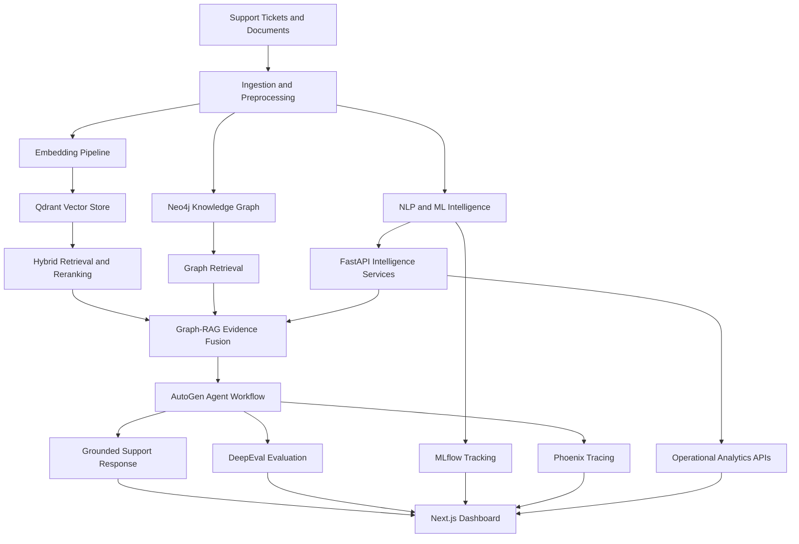
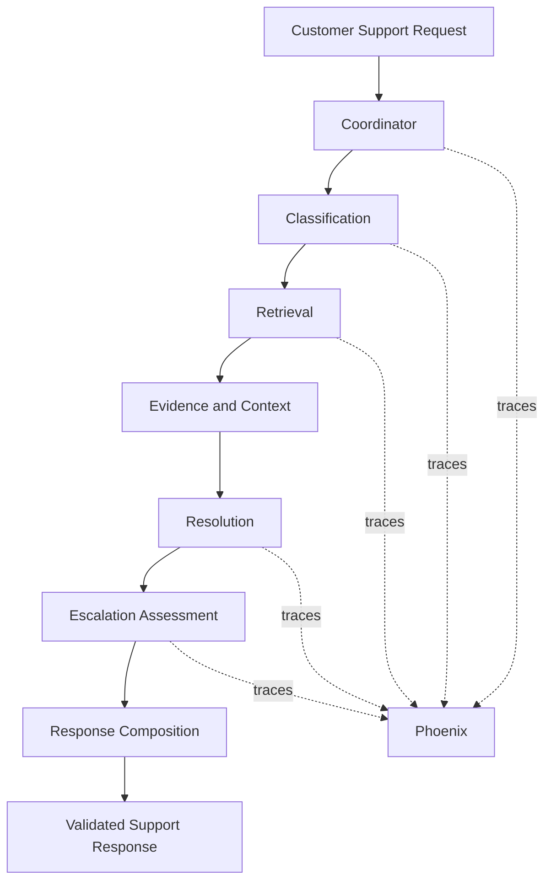

# SupportMind AI
### Enterprise Customer & Issue Intelligence Platform

SupportMind AI transforms fragmented customer-support data into actionable intelligence. It combines NLP and machine learning, hybrid retrieval, knowledge graphs, Graph-RAG, agentic AI, and operational analytics in a single platform.

Rather than treating customer support as a question-and-answer chatbot, SupportMind connects historical tickets, organizational knowledge, workflow events, and AI-assisted reasoning to help support teams understand issues, retrieve relevant evidence, recommend resolutions, and discover operational patterns.

**Repository:** [Daniel-mass/supportmind-ai](https://github.com/Daniel-mass/supportmind-ai)

---

## Table of Contents

- [Overview](#overview)
- [Key Capabilities](#key-capabilities)
- [Architecture](#architecture)
- [Technology Stack](#technology-stack)
- [Machine Learning and NLP](#machine-learning-and-nlp)
- [Retrieval and Graph-RAG](#retrieval-and-graph-rag)
- [Agentic AI](#agentic-ai)
- [Operational Intelligence](#operational-intelligence)
- [Evaluation and Observability](#evaluation-and-observability)
- [Frontend](#frontend)
- [API Reference](#api-reference)
- [Deployment and CI](#deployment-and-ci)
- [Getting Started](#getting-started)
- [Configuration](#configuration)
- [Data and Model Artifacts](#data-and-model-artifacts)
- [Engineering Principles](#engineering-principles)
- [Limitations and Scope](#limitations-and-scope)
- [Roadmap](#roadmap)

---

## Overview

Customer-support organizations generate large volumes of tickets, documents, workflow events, and historical resolutions. These signals are often fragmented across systems, making it difficult to retrieve relevant knowledge, identify recurring issues, and understand operational inefficiencies.

SupportMind AI addresses this problem through an integrated intelligence pipeline:

**Collect → Understand → Retrieve → Reason → Recommend → Evaluate → Discover**

The platform combines two complementary forms of intelligence:

- **Customer-support intelligence:** ticket classification, priority detection, semantic retrieval, evidence-grounded assistance, and AI agent workflows.
- **Organizational intelligence:** ticket and agent analytics, workflow bottlenecks, handoff analysis, workflow variants, emerging issues, and graph-based exploration.

The project uses public development datasets and a synthetic company knowledge base to demonstrate these capabilities without requiring access to a real organization's private customer data.

## Key Capabilities

- **NLP and machine learning:** ticket-category classification, priority detection, conversation-complexity modelling, semantic similarity, and unsupervised topic discovery.
- **Hybrid retrieval:** dense vector search combined with BM25 sparse retrieval, Reciprocal Rank Fusion (RRF), and reranking.
- **Knowledge graphs:** Neo4j-based retrieval relationships and structured operational workflow graphs.
- **Graph-RAG:** combines graph and vector evidence with provenance preservation, evidence ranking, citation checks, and groundedness validation.
- **Agentic support:** AutoGen-based orchestration for classification, retrieval, resolution, escalation, and response composition.
- **Operational analytics:** ticket, agent, team, organization, workflow, handoff, and bottleneck intelligence.
- **AI evaluation:** DeepEval integration and evaluation-result reporting.
- **Observability and MLOps:** Phoenix tracing and MLflow experiment/evaluation tracking.
- **Enterprise-style dashboard:** a Next.js interface for support assistance, intelligence dashboards, evaluations, and observability.
- **Containerization and orchestration:** Docker, Docker Compose, Kubernetes, Minikube, and Helm.
- **Continuous integration:** GitHub Actions for automated repository checks and container builds.

---

## Architecture



### Main components

| Component | Responsibility |
|---|---|
| Ingestion | Load, parse, normalize, preprocess, and chunk source data. |
| NLP/ML | Produce ticket classifications, priority predictions, conversation-complexity signals, and topic assignments. |
| Qdrant | Store and retrieve vector representations. |
| Neo4j | Represent retrieval relationships and operational workflow graphs. |
| Retrieval | Combine dense search, BM25, fusion, and reranking. |
| Graph-RAG | Combine relevant evidence and generate grounded responses. |
| AutoGen | Orchestrate support-assistance agents and workflow execution. |
| Intelligence services | Calculate deterministic ticket, agent, workflow, and organization metrics. |
| FastAPI | Expose application capabilities through HTTP endpoints. |
| DeepEval | Evaluate configured LLM/RAG outputs. |
| Phoenix | Trace agent execution and inspect workflow spans. |
| MLflow | Track ML experiments, evaluation runs, parameters, metrics, and artifacts. |
| Next.js | Present support assistance, analytics, evaluation, and observability interfaces. |

Qdrant, Neo4j, Ollama, and individual agents are internal components rather than separate public SupportMind application APIs.

---

## Technology Stack

| Layer | Technologies |
|---|---|
| Frontend | Next.js, TypeScript, Tailwind CSS, shadcn |
| State and data fetching | Zustand, TanStack Query |
| Visualizations | Recharts, React Flow, Lucide |
| Backend | Python 3.11, FastAPI, Pydantic |
| NLP and ML | scikit-learn, Transformers, DistilBERT, BERTopic |
| Embeddings | FastEmbed and embedding-provider abstractions |
| Vector database | Qdrant |
| Knowledge graph | Neo4j |
| Retrieval | Dense retrieval, BM25, RRF, ColBERT, Cross-Encoder baseline |
| LLM inference | Ollama, Qwen3:8b |
| Agent orchestration | AutoGen |
| Evaluation | DeepEval |
| Observability | Phoenix, OpenTelemetry |
| Experiment tracking | MLflow |
| Containerization | Docker, Docker Compose |
| Orchestration | Kubernetes, Minikube, Helm |
| CI | GitHub Actions |

---

## Machine Learning and NLP

SupportMind uses different datasets and modelling strategies for different tasks rather than forcing every problem into a single model.

| Capability | Approach | Purpose |
|---|---|---|
| Ticket-category classification | Word and character TF-IDF features with class-balanced Logistic Regression | Predict a category from ticket subject and description. |
| Priority detection | Feature-engineered ExtraTrees classifier with class balancing | Estimate ticket priority from available, non-leaking features. |
| Conversation complexity | DistilBERT classification task using customer conversation structure | Distinguish single-turn and multi-turn conversation patterns. |
| Semantic similarity | Embeddings and vector retrieval | Find semantically related historical content. |
| Issue discovery | BERTopic with BGE-base embeddings, UMAP, and HDBSCAN | Discover recurring issue clusters without requiring predefined labels. |
| Sentiment | Available sentiment signals where applicable | Provide supporting context, not a universal sentiment-prediction guarantee. |

### Topic modelling

The documented BERTopic experiment used 8,460 issue-bearing ticket documents and discovered 59 actual topics, with 1,379 documents assigned to the outlier cluster.

Reported experiment metrics:

- Topic assignment coverage: **83.70%**
- Outliers: **16.30%**
- C_V coherence: **0.7972**
- Topic diversity: **0.5983**

Topic IDs are model-generated clusters, not permanent business categories. Topic labels and possible explanations require appropriate interpretation.

### Deliberate scope decisions

Intent classification, named entity recognition (NER), ML-based urgency prediction, and ML-based escalation prediction were removed from the implemented ML scope because the available data did not justify presenting them as validated models.

Conversation-complexity training and model-artifact availability must be checked against the current repository before assuming that a trained checkpoint is included in a fresh clone.

---

## Retrieval and Graph-RAG

SupportMind implements a retrieval pipeline designed to combine semantic relevance, lexical matching, graph relationships, and evidence provenance.

### Retrieval pipeline

1. Load and preprocess source content.
2. Create chunks and embeddings.
3. Store vectors in Qdrant.
4. Retrieve candidates using dense vector search and BM25.
5. Combine ranked results using Reciprocal Rank Fusion.
6. Deduplicate candidates and rerank them.
7. Build a bounded context from selected evidence.
8. Combine vector and graph evidence for Graph-RAG.
9. Generate a response and validate citations and groundedness.

### Retrieval components

- **Dense retrieval:** semantic similarity through vector search.
- **Sparse retrieval:** BM25 lexical matching.
- **Hybrid retrieval:** combines dense and sparse candidates.
- **RRF:** fuses independently ranked results.
- **Reranking:** ColBERT-based reranking, with a Cross-Encoder baseline.
- **Graph retrieval:** traverses relationships represented in Neo4j.
- **Evidence handling:** retains provenance and supports citation validation.

Graph-RAG is not simply a graph visualization or a synonym for ordinary RAG. It combines retrieved evidence from graph and vector sources before generation.

---

## Agentic AI

The support-assistance workflow uses AutoGen orchestration and structured application models.



### Agent responsibilities

- **Coordinator:** manages the overall support workflow.
- **Classification:** supplies available ticket and request classification signals.
- **Retrieval:** retrieves relevant knowledge and historical evidence.
- **Resolution:** proposes a resolution grounded in the supplied context.
- **Escalation:** assesses whether additional human intervention is appropriate.
- **Response composition:** communicates the upstream results in a clear response.

Structured validation helps ensure that evidence references point to evidence actually supplied to the workflow. Grounding and citation checks reduce unsupported output, but do not guarantee that every generated statement is correct.

The unified Support Assist endpoint is the application entry point; individual agents are internal workflow components.

---

## Operational Intelligence

In addition to generated support responses, SupportMind provides deterministic analytics through its intelligence layer.

### Ticket intelligence
Structured ticket information and associated operational signals.

### Agent and team intelligence
Metrics and relationships derived from available ticket and workflow data.

### Workflow intelligence
- Lifecycle and waiting-time metrics.
- Status transitions and workflow intervals.
- Agent handoffs.
- Bottleneck candidates.
- Grouped workflow variants.

### Organization intelligence
Aggregated ticket, agent, team, and workflow analytics, including trends and emerging-issue views.

The intelligence layer uses canonical schemas and dedicated services to separate analytics from presentation. FastAPI returns structured data; the Next.js frontend visualizes it.

**Important:** bottlenecks and issue spikes are analytical signals, not proof of causal root causes. Claims such as a particular payment gateway being the root cause require supporting evidence.

---

## Evaluation and Observability

SupportMind separates evaluation, execution tracing, and experiment tracking.

| System | Role |
|---|---|
| DeepEval | Evaluate configured LLM/RAG behaviour and present evaluation results. |
| Phoenix | Inspect agent workflow traces, spans, inputs/outputs, and execution behaviour. |
| MLflow | Track experiments, parameters, metrics, artifacts, and model/evaluation runs. |

### Grounding and evidence validation

The Graph-RAG workflow includes citation and groundedness checks. These are application-level safeguards and are distinct from benchmark-based evaluation.

### Phoenix

OpenTelemetry-based tracing captures the support workflow and agent execution. The Phoenix interface is used to inspect traces and diagnose execution behaviour.

### MLflow

MLflow uses a persistent tracking backend and artifact storage in the local development setup. The dashboard connects to the application's MLflow observability integration.

### Evaluation scope

DeepEval is the configured evaluation framework. RAGAS was removed from the agreed project scope; it should not be treated as an active evaluation dependency.

---

## Frontend

The Next.js application acts as the platform's operational cockpit rather than just a chat window.

The implemented dashboard structure includes:

- **Overview:** platform-level operational summaries.
- **AI Support:** unified support-assistance interface.
- **Tickets:** ticket-related views.
- **Intelligence:** ticket intelligence, ML intelligence, knowledge/retrieval, and graph intelligence.
- **Agent Operations:** agent intelligence and workflow views.
- **Organization:** trends, emerging issues, and operational insights.
- **Evaluation:** evaluation results and model-related views.
- **Observability:** Phoenix, MLflow, and system-health views.

The exact data shown in each view depends on its connected API and the availability of underlying datasets or artifacts. These dashboards should not be interpreted as evidence that every planned enterprise connector or customer portal has been implemented.

---

## API Reference

FastAPI provides interactive API documentation when the backend is running.

| Method | Endpoint | Purpose |
|---|---|---|
| GET | `/api/v1/health` | Application health. |
| POST | `/api/v1/support/assist` | Unified AI support workflow. |
| GET | `/api/v1/tickets/{ticket_id}/intelligence` | Ticket intelligence. |
| GET | `/api/v1/workflow/{ticket_id}/intelligence` | Workflow intelligence. |
| GET | `/api/v1/agents/{agent_id}/intelligence` | Agent intelligence. |
| GET | `/api/v1/organization/intelligence` | Organization-level intelligence. |
| POST | `/api/v1/graph-rag/query` | Graph-RAG query workflow. |
| GET | `/api/graph-rag/health` | Graph-RAG health check. |

Evaluation and MLflow observability routes are also part of the application API surface. Consult the running OpenAPI specification for the exact current paths and request schemas.

### Example: Support Assist

Request:

```http
POST /api/v1/support/assist
Content-Type: application/json
```

```json
{
  "request": "I need help with a refund that has not arrived."
}
```

The response contains the support result and relevant workflow information according to the current API schema, including available evidence and intelligence data.

### Interactive API documentation

Once the backend is running, open:

- Swagger UI: `http://127.0.0.1:8000/docs`
- OpenAPI schema: `http://127.0.0.1:8000/openapi.json`

---

## Deployment and CI

### Docker

The backend Dockerfile uses Python 3.11 slim, installs dependencies from `requirements.txt`, copies the application, and runs Uvicorn on port `8000`.

The development environment uses a shared Docker network for the API, Phoenix, Qdrant, and Neo4j. Ollama and MLflow may run on the Windows host and be accessed from containers through `host.docker.internal`.

The exact dependency startup arrangement is defined by the repository's Compose and service configuration.

### Kubernetes and Minikube

The project includes Kubernetes configuration for the API, including a Deployment, Service, ConfigMap, and external secret configuration.

Minikube is used for local Kubernetes deployment and validation. The current development setup can mount the raw dataset directory from Windows into the cluster; that local host mount is not a portable production storage solution.

### Helm

The Helm chart is maintained under `helm/supportmind`. It templates the API Deployment, Service, and configuration from chart values.

Example commands from the repository root:

```powershell
helm lint .\helm\supportmind
helm template supportmind .\helm\supportmind
helm upgrade --install supportmind .\helm\supportmind -n supportmind --create-namespace
```

If an existing Kubernetes Deployment already owns the same resources, review the release and resource ownership before installing or adopting them. Do not blindly apply the example command over an existing deployment.

### GitHub Actions

The repository includes a GitHub Actions CI workflow covering frontend checks/build, backend Python syntax validation, and backend Docker image building.

[View GitHub Actions runs](https://github.com/Daniel-mass/supportmind-ai/actions)

CI verifies selected build checks. It is not, by itself, a production deployment pipeline. Existing frontend lint issues and the workflow's lint-step configuration should be reviewed separately.

---

## Getting Started

### Prerequisites

Install the tools needed for the components you intend to run:

- Git
- Python 3.11
- Conda or another Python environment manager
- Node.js and npm
- Docker Desktop
- Ollama with the required local model
- Qdrant and Neo4j
- MLflow and Phoenix for evaluation/observability features

Minikube, kubectl, and Helm are needed for the Kubernetes deployment path.

### 1. Clone the repository

```powershell
git clone https://github.com/Daniel-mass/supportmind-ai.git
cd supportmind-ai
```

### 2. Set up the backend environment

```powershell
conda create -n supportmind python=3.11 -y
conda activate supportmind

python -m pip install --upgrade pip
pip install -r backend/requirements.txt
```

Use the dependency file present in the checked-out revision. If the repository's current dependency layout differs, follow that layout rather than installing duplicate dependency sets.

### 3. Configure environment variables

Create local environment configuration based on the variables required by the current backend settings and deployment configuration. Do not commit secrets, credentials, private datasets, or local `.env` files.

See [Configuration](#configuration).

### 4. Start the backend

From the repository root:

```powershell
cd backend
python -m uvicorn app.main:app --host 127.0.0.1 --port 8000
```

Check health:

```powershell
Invoke-RestMethod http://127.0.0.1:8000/api/v1/health
```

Open the interactive API documentation at `http://127.0.0.1:8000/docs`.

### 5. Set up the frontend

In a separate PowerShell terminal:

```powershell
cd frontend
npm install
npm run dev
```

Open `http://localhost:3000`.

### 6. Start supporting services

Start Qdrant, Neo4j, Ollama, Phoenix, and MLflow according to the configuration for the chosen execution mode. Ensure that the backend's URLs, credentials, model names, vector collection, and dataset paths match the services actually running.

The complete AI workflow requires its corresponding models, data, and infrastructure. Starting FastAPI alone does not automatically initialize every dependency.

---

## Configuration

The following are representative configuration values from the local development setup. They are examples, not a substitute for the current settings or Helm values.

| Variable | Purpose | Example |
|---|---|---|
| `OLLAMA_HOST` | Ollama endpoint | `http://host.docker.internal:11434` from a container |
| `SUPPORTMIND_LLM_MODEL` | Support generation model | `qwen3:8b` |
| `SUPPORTMIND_GRAPH_RAG_MODEL` | Graph-RAG model | `qwen3:8b` |
| `QDRANT_URL` | Qdrant endpoint | `http://sharebot-qdrant:6333` on the shared Docker network |
| `QDRANT_HOST` | Qdrant host | `sharebot-qdrant` |
| `NEO4J_URI` | Neo4j connection | `bolt://neo4j-sentinel:7687` on the shared Docker network |
| `NEO4J_USERNAME` | Neo4j username | Configured locally |
| `NEO4J_PASSWORD` | Neo4j password | Supplied through a secret |
| `NEO4J_DATABASE` | Neo4j database | `neo4j` |
| `PHOENIX_COLLECTOR_ENDPOINT` | Trace collector | `http://phoenix:6006/v1/traces` |
| `MLFLOW_TRACKING_URI` | MLflow server | `http://host.docker.internal:5000` from a container |

Other settings may be required for dataset locations, embedding models, collection names, artifact paths, and evaluation results.

**Networking note:** `host.docker.internal` is intended for container-to-host access in the local Docker Desktop environment. Container-to-container URLs should use the appropriate service/container network names. Kubernetes networking and mounted data paths must be configured separately.

Never expose database passwords, tokens, API keys, or customer information in source control.

---

## Data and Model Artifacts

SupportMind uses task-specific datasets and artifacts.

| Dataset or source | Purpose |
|---|---|
| Customer Support Tickets Dataset | Semantic similarity and BERTopic issue discovery. |
| IT Helpdesk Synthetic Tickets | Ticket-category classification. |
| Help Desk Tickets and change history | Priority modelling and operational/workflow intelligence. |
| Customer Support on Twitter | Conversation-complexity task development. |
| NovaCare synthetic knowledge base | Knowledge retrieval and support-assistance demonstrations. |
| Enron Email Dataset | Potential development/testing source for email-oriented workflows. |

Raw datasets are not required to be committed to GitHub. Supply them locally according to the configured paths and any applicable dataset licences.

Some trained model artifacts in the development environment exceeded GitHub's 100 MB file limit and were excluded from version control. A fresh clone may therefore require separately obtaining or regenerating particular artifacts before every ML feature can run.

The BERTopic experiment also relies on the matching embedding model at inference time because its training embeddings were supplied separately.

---

## Engineering Principles

SupportMind follows several deliberate design decisions:

- **Evidence before generation:** retrieve and rank evidence before composing support responses.
- **Provenance preservation:** retain source information so generated answers can be inspected.
- **Structured contracts:** use Pydantic schemas and canonical intelligence models between services.
- **Separation of responsibilities:** keep retrieval, graph storage, operational analytics, agent orchestration, evaluation, and frontend presentation distinct.
- **Data-driven modelling:** implement tasks supported by available data instead of claiming unsupported capabilities.
- **Deterministic operational analytics:** calculate workflow and organizational metrics independently of LLM-generated explanations.
- **Local-first inference option:** use Ollama for local model execution in the development setup.
- **Observability:** use Phoenix for execution tracing and MLflow for experiment/evaluation tracking.
- **Reproducible deployment:** use container images, Kubernetes manifests, and Helm configuration where appropriate.

---

## Limitations and Scope

SupportMind is a portfolio-grade engineering project with production-oriented architecture; it should not be confused with a fully managed enterprise SaaS deployment.

- Gmail, Outlook, Zendesk, Freshdesk, Jira Service Management, Confluence, Notion, Slack, and Teams are examples of potential source integrations, **not claims of completed live connectors**.
- The current data ingestion implementation should not be described as a continuous enterprise connector platform.
- Intent classification, NER, ML-based urgency detection, and ML-based escalation prediction were removed from the supported ML scope.
- Topic clusters are exploratory signals and do not establish causal root causes.
- Generated resolution suggestions require appropriate validation and human oversight in consequential support workflows.
- Grounding and citation validation reduce unsupported answers but cannot eliminate all hallucinations.
- Local Minikube deployment is a development environment, not evidence of a production cloud deployment.
- CI does not imply that a CD pipeline, automated cloud rollout, Prometheus/Grafana monitoring, alerting, or production SLA guarantees are in place.
- Model and dataset availability depends on local configuration and whether large artifacts have been separately obtained.

---

## Roadmap

Potential next steps, subject to validation against the current implementation:

- Reproducible model-artifact distribution and setup checks.
- Broader automated backend and frontend test coverage.
- End-to-end deployment and smoke-test automation.
- More robust ingestion adapters for real enterprise source systems.
- Production-grade secret management and persistent infrastructure.
- Additional service metrics, alerting, and operational monitoring.
- Deployment to a managed Kubernetes environment when required.

---

## License

Add the appropriate license file before distributing or reusing this project. Verify the licences of datasets, model weights, and dependencies independently.

---

**SupportMind AI** — connecting customer-support evidence, AI-assisted resolution, and organizational intelligence in one platform.
